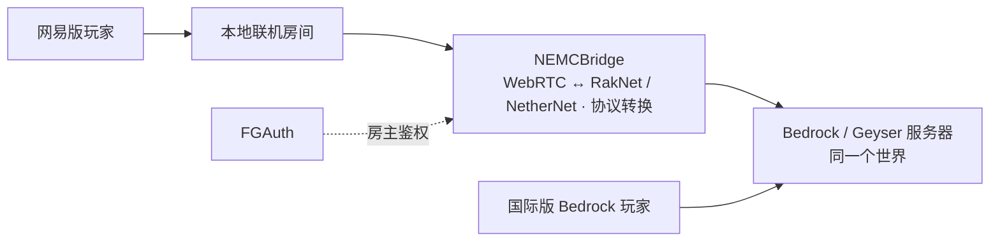

<p align="center">
  
</p>

<h1 align="center">NEMCBridge</h1>

<p align="center">让网易版与国际版 Bedrock 玩家，在同一个世界相遇。</p>

<p align="center">
  <a href="https://nemcbridge.ucket.top/">项目官网</a> ·
  <a href="https://nemcbridge.ucket.top/wiki/">中文文档</a> ·
  <a href="https://github.com/UCKETX/NEMCBridge/releases/latest">下载正式版</a> ·
  <a href="https://github.com/UCKETX/NEMCBridge/releases">全部版本</a> ·
  <a href="docs/compatibility.md">兼容范围</a> ·
  <a href="https://github.com/UCKETX/NEMCBridge/issues">问题反馈</a>
</p>

<p align="center">
  <a href="https://github.com/UCKETX/NEMCBridge/releases/latest"></a>
  <a href="https://github.com/UCKETX/NEMCBridge/releases"></a>
  <a href="https://github.com/UCKETX/NEMCBridge/releases"></a>
  <a href="LICENSE"></a>
</p>

---

## 简介

**NEMCBridge** 通过 FGAuth 登录房主机器人，常驻创建网易《我的世界》「本地联机」房间，并将网易玩家连接实时转换并转发到你自己的 Bedrock（或 Geyser + Java）服务器。网易玩家搜索房间号即可进入，国际版 Bedrock 玩家直接连接同一台服务器，无需在客户端安装模组或插件。



## 核心特性

### 互通与多服架构
- **原版跨端互通**：支持区块加载、方块破坏与放置、双向聊天、玩家皮肤与已适配 4D 装扮互显，以及按稳定网易账号隔离后端离线存档。
- **多房间与选服大厅**：不设房间和国际服数量上限；支持**选服大厅（单房多服）**，一个网易房间可接入 2–8 个国际服，游戏内带在线/离线状态提示并自动转服。
- **突破 10 人限制（Beta）**：支持公网固定 UDP `19441` 网关自动转服与轻量入口，交接后自动释放网易大厅名额，多国际服共用单端口；超过 9 位访客同时在线尚未实测。详见[转服网关文档](docs/handoff.md)。
- **跨版本与自动外观**：实验性支持所列 `1.21.120–26.60`（协议 `859–2225`）后端及 Purpur / Paper + Geyser；按后端协议自动下载、SHA256 校验、缓存并下发兼容资源包，无需手动导入。见[多版本说明](docs/multiversion.md)与[适配清单](docs/compatibility-status-26.60.md)。

### 运维与安全能力
- **玩家真实 IP 透传（v1.6.1-beta.1+）**：自动向后端 `Login` `ClientData` 写入防伪造的 `ClientIP` / `ClientPort`，同步原子更新 `logs/player_ips.json` 并在日志中记录来源地址；支持按国际服可选开启 **UDP HAProxy PROXY Protocol v2**（适配 Geyser 等兼容后端，无需改插件即可原生显示真实 IP）。
- **Web 管理控制台**：内置管理员登录（首次启动使用终端一次性初始化码），集中管理国际服、选服大厅、网易账号、好友申请与私信、实时概览及可筛选/搜索/轮转的运行日志。
- **签名校验一键更新**：支持在控制台自动检查、下载、校验 SHA256 与 Ed25519 发布签名并重启升级，GitHub 访问受限时自动切换内置加速镜像。
- **跨平台开箱即用**：提供 Windows、Linux、macOS 的 `amd64` / `arm64` 单文件发布包；Windows 凭据使用 DPAPI 加密，Linux/macOS 以 `0600` 权限保护。

---

## 快速开始

> 完整图文教程与运维手册请访问 **[中文 Wiki（nemcbridge.ucket.top）](https://nemcbridge.ucket.top/wiki/quick-start/)**。

### 1. 准备后端服务器

运行你自己的 Bedrock Dedicated Server（BDS）、Purpur / Paper + Geyser 或其他已验证的基岩服务端。网易侧固定使用协议 `898`，国际服侧推荐 **BDS `1.21.130.4`**，并实验性支持所列 **`1.21.120–26.60`** 构建。

在 BDS 的 `server.properties` 中设置：

```properties
online-mode=false
compression-algorithm=zlib
block-network-ids-are-hashes=true
```

> NEMCBridge 会将玩家映射为稳定的后端离线身份，因此后端需关闭 Xbox 正版校验；离线身份不代表 Xbox 认证，请合理配置防火墙和游戏权限。

### 2. 下载并启动

前往 [Releases](https://github.com/UCKETX/NEMCBridge/releases/latest)（或 [全部版本](https://github.com/UCKETX/NEMCBridge/releases) 获取 Beta 预发布版）下载对应平台的压缩包：

| 系统 | 发布包 | 常见架构 |
| --- | --- | --- |
| Windows | `NEMCBridge_*_windows_*.zip` | 常规 PC 选 `amd64`，ARM 设备选 `arm64` |
| Linux | `NEMCBridge_*_linux_*.tar.gz` | x86_64 服务器选 `amd64`，ARM64 服务器选 `arm64` |
| macOS | `NEMCBridge_*_macos_*.tar.gz` | Apple Silicon 选 `arm64`，Intel 选 `amd64` |

Windows 解压后双击 `NEMCBridge.exe`；Linux / macOS 在解压目录执行：

```sh
chmod +x NEMCBridge
./NEMCBridge -data-dir ./data
```

### 3. 初始化并开房

1. 打开控制台（默认 `http://127.0.0.1:18321/`，终端会输出局域网地址），输入终端显示的一次性初始化码并创建管理员账号。
2. 在 **设置** 中确认 [FGAuth 验证服务器](https://fgauth.ucket.top) 地址（需支持安全开房与房间票据回传）。
3. 在 **国际服** 添加后端地址（同机 BDS 默认为 `127.0.0.1:19132`，BDS 26.60 NetherNet 填 `http://127.0.0.1:19132`）。
4. 在 **网易账号** 添加机器人令牌，在 **桥接** 绑定账号与国际服（或选服大厅），最后在 **概览** 点击 **启动房间**。
5. 网易玩家在「本地联机」搜索控制台显示的房间号即可进服；同一机器人账号请保持仅在此处登录。

---

## 兼容范围与文档导航

| 组件 | 推荐 / 已验证范围 |
| --- | --- |
| 网易客户端 | `3.10.5.301327`（协议 `898`） |
| 网易房间内核 | `1.21.130.0`（房间协议由 FGAuth 返回） |
| 官方 BDS | 推荐 `1.21.130.4`（`898`）；实验性覆盖所列 `1.21.120–26.60`（`859–2225`） |
| 其他服务端 | Purpur / Paper + Geyser（`859–2225`）、LeviLamina、Endstone、PocketMine-MP、PowerNukkitX、Nukkit / Nukkit-MOT、Allay、Cloudburst、Dragonfly |

- [官网与中文文档（推荐）](https://nemcbridge.ucket.top/wiki/)
- [部署指南](docs/setup.md)（含真实 IP 透传、PROXY Protocol v2、远程管理与升级校验）
- [自动转服与选服大厅](docs/handoff.md)
- [多版本支持](docs/multiversion.md) · [26.60 适配清单](docs/compatibility-status-26.60.md)
- [服务端兼容报告](docs/server-compatibility.md) · [完整兼容性边界](docs/compatibility.md)
- [资源包与材质说明](docs/resource-packs.md) · [更新日志](CHANGELOG.md)

---

## 反馈与安全

- **功能建议与故障反馈**：请前往 [GitHub Issues](https://github.com/UCKETX/NEMCBridge/issues)，提交前请先核对兼容范围，切勿贴出机器人令牌、`secrets.dat` 或未脱敏的私密日志。
- **安全漏洞报告**：请按 [SECURITY.md](SECURITY.md) 的私密渠道反馈。

## 致谢与声明

感谢 [nemc-tan-lobby-solver](https://github.com/Happy2018new/nemc-tan-lobby-solver)、[gophertunnel](https://github.com/Sandertv/gophertunnel)、[Pion](https://github.com/pion)、[neomega-admin](https://github.com/UCKETX/neomega-admin) 及相关协议研究。第三方组件各自保留原许可证，详见 [THIRD_PARTY_NOTICES.md](THIRD_PARTY_NOTICES.md)。

本仓库用于发布 NEMCBridge 预编译安装包与用户文档；项目官网与中文文档位于 [nemcbridge.ucket.top](https://nemcbridge.ucket.top/)。

本项目为独立社区工具，与 Mojang、Microsoft 或网易无隶属、赞助或官方合作关系。Minecraft 及相关商标归各自权利人所有。
