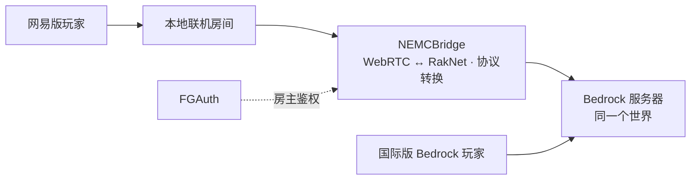

<p align="center">
  
</p>

<h1 align="center">NEMCBridge</h1>

<p align="center">让网易版与国际版 Bedrock 玩家，在同一个世界相遇。</p>

<p align="center">
  <a href="https://ucketx.github.io/NEMCBridge/">项目官网</a> ·
  <a href="https://github.com/UCKETX/NEMCBridge/releases/latest">下载版本</a> ·
  <a href="docs/setup.md">部署指南</a> ·
  <a href="docs/compatibility.md">兼容范围</a> ·
  <a href="CONTRIBUTING.md">参与开发</a>
</p>

<p align="center">
  <a href="https://github.com/UCKETX/NEMCBridge/actions/workflows/release.yml"></a>
  <a href="https://github.com/UCKETX/NEMCBridge/releases/latest"></a>
  <a href="LICENSE"></a>
</p>

## 它能做什么

NEMCBridge 通过 FGAuth 登录房主机器人，持续创建网易《我的世界》的「本地联机」房间，再将玩家连接转发到已有的 Bedrock 服务器。网易玩家从房间加入，国际版 Bedrock 玩家直接连接同一台服务器。

- **共同游玩**：区块加载、方块破坏与放置、双向文字聊天和玩家皮肤互显。
- **房主常驻**：机器人保持房间连接，掉线后自动重试开房；重新开房时房间号可能变化。
- **多房间**：用多个机器人账号同时开最多 8 个房间，突破单个网易房间 9 名玩家的限制，全部进入同一个世界。
- **自动加好友**：机器人定时同意收到的好友申请，控制台可关闭。
- **网页管理**：内置带管理员登录的 Web 控制台，配置验证服务器、令牌、后端地址和房间参数，查看连接状态与日志。
- **终端启动界面**：蓝青色块字横幅，显示版本、访问地址和首次登录信息。
- **跨平台部署**：Windows、Linux、macOS，分别提供 amd64 与 arm64 发布包。
- **本地管理凭据**：Windows 使用 DPAPI 加密；Linux/macOS 以 `0600` 权限保存令牌。



## 快速开始

### 1. 准备后端

运行自己的 Bedrock Dedicated Server（BDS）。已验证版本为 **1.21.124.2**，在 `server.properties` 中设置：

```properties
online-mode=false
compression-algorithm=zlib
block-network-ids-are-hashes=true
```

NEMCBridge 需要将玩家转为后端的离线身份，因此后端关闭 Xbox 正版登录校验；玩家身份不应被当作已认证的 Xbox 身份。请按自己的访问范围配置后端防火墙及权限。服务器程序和世界需要自行准备。

### 2. 下载并启动

从 [Releases](https://github.com/UCKETX/NEMCBridge/releases/latest) 下载对应平台和架构：

| 系统 | 文件 | 常见架构 |
| --- | --- | --- |
| Windows | `windows_*.zip` | 大多数 PC 选 `amd64`，ARM 设备选 `arm64` |
| Linux | `linux_*.tar.gz` | x86 服务器选 `amd64`，ARM 服务器选 `arm64` |
| macOS | `macos_*.tar.gz` | Apple Silicon 选 `arm64`，Intel 选 `amd64` |

Windows 解压后双击 `NEMCBridge.exe`。Linux/macOS 在解压目录执行：

```sh
chmod +x NEMCBridge
./NEMCBridge -data-dir ./data
```

管理页面默认监听 `0.0.0.0:18321`，启动终端会显示局域网访问地址。本机打开 [http://127.0.0.1:18321/](http://127.0.0.1:18321/)，同一网络的设备使用终端显示的地址。账号为 `admin`，首次启动时终端会显示随机生成的管理密码；登录后填写 [FGAuth 验证服务器](https://fgauth.ucket.top)、自己的机器人令牌和后端地址，保存并点击「开房」。后端在同一台机器时，默认地址为 `127.0.0.1:19132`。

### 3. 一起加入

网易玩家在「本地联机」中搜索控制台显示的房间号；国际版 Bedrock 玩家通过服务器地址和 UDP 端口加入同一个 BDS。让机器人账号只保留一个登录会话。

当前网易本地联机房间按总人数 10 人限制处理，机器人占 1 个名额，最多接入 9 名网易玩家。修改 BDS 的 `max-players` 不会提高网易房间容量；国际版直连不占网易房间名额，但会计入 BDS 人数。

更多配置、远程管理、升级及常见问题见 [部署指南](docs/setup.md)。

## 兼容范围

| 组件 | 已验证组合 |
| --- | --- |
| 网易客户端 | `3.9.41.300665` |
| 网易房间版本 / 协议 | `1.21.120.0` / `42` |
| BDS | `1.21.124.2`，游戏协议 `860` |
| 国际版客户端 | Bedrock `1.21.124` |

Windows 环境已完成真实客户端互通验证；Actions 覆盖三个系统的自动测试和六个平台架构的构建。其他游戏版本、特殊皮肤及模组内容需要另行验证。

网易端目前**跳过服务端资源包和行为包**，使用客户端已有资源。依赖这些包的自定义内容可能无法正常显示；国际版直连的资源包流程不受影响。Java 版客户端不在支持范围内。

完整边界见 [兼容性说明](docs/compatibility.md)。

## 从源码构建

使用 `go.mod` 指定的 Go 工具链；当前为 Go `1.26.9`。

```sh
git clone https://github.com/UCKETX/NEMCBridge.git
cd NEMCBridge
go test ./...
go build -trimpath -o build/NEMCBridge ./cmd/nemcbridge
./build/NEMCBridge -data-dir ./data/dev
```

Windows 可执行 `powershell -ExecutionPolicy Bypass -File scripts/build.ps1` 构建 `build/NEMCBridge.exe`。

```text
.github/       测试、构建、发布和协作模板
cmd/nemcbridge/ 程序入口
docs/          部署、兼容性、协议说明及图片
internal/app/  控制台、房间管理和运行日志
internal/webui/ 嵌入可执行文件的 Web 控制台
internal/      鉴权、房间、转发、协议转换和数据存储等模块
scripts/       构建、打包及本地测试工具
site/          项目官网（GitHub Pages）
vendor-src/    保留本地修改的上游协议模块
```

本地生成的文件集中放在 `build/`（程序和打包产物）、`data/`（配置、凭据、日志）和 `runtime/`（测试服务器与临时诊断工具），这些目录不提交到仓库。

开发与集成测试见 [CONTRIBUTING.md](CONTRIBUTING.md)，版本变化见 [CHANGELOG.md](CHANGELOG.md)。

## 致谢与许可

感谢 [nemc-tan-lobby-solver](https://github.com/Happy2018new/nemc-tan-lobby-solver)、[gophertunnel](https://github.com/Sandertv/gophertunnel)、[Pion](https://github.com/pion)、[neomega-admin](https://github.com/UCKETX/neomega-admin) 及相关协议研究。协议适配参考与实现边界见 [协议说明](docs/protocol.md)。

NEMCBridge 原创代码和文档采用 [MIT License](LICENSE)。`vendor-src/` 中的第三方代码不因本项目的 MIT 声明而重新授权；各组件的许可和上游许可缺失情况见 [THIRD_PARTY_NOTICES.md](THIRD_PARTY_NOTICES.md)。

本项目为独立社区工具，与 Mojang、Microsoft 或网易无隶属、赞助或官方合作关系。Minecraft 及相关商标归各自权利人所有。
