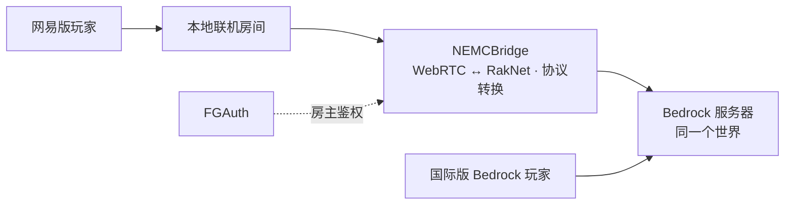

<p align="center">
  
</p>

<h1 align="center">NEMCBridge</h1>

<p align="center">让网易版与国际版 Bedrock 玩家，在同一个世界相遇。</p>

<p align="center">
  <a href="https://ucketx.github.io/NEMCBridge/">项目官网</a> ·
  <a href="https://github.com/UCKETX/NEMCBridge/releases/latest">下载版本</a> ·
  <a href="docs/setup.md">部署指南</a> ·
  <a href="docs/compatibility.md">兼容范围</a> ·
  <a href="https://github.com/UCKETX/NEMCBridge/issues">问题反馈</a>
</p>

<p align="center">
  <a href="https://github.com/UCKETX/NEMCBridge/releases/latest"></a>
  <a href="https://github.com/UCKETX/NEMCBridge/releases"></a>
</p>

## 它能做什么

NEMCBridge 通过 FGAuth 登录房主机器人，持续创建网易《我的世界》的「本地联机」房间，再将玩家连接转发到已有的 Bedrock 服务器。网易玩家从房间加入，国际版 Bedrock 玩家直接连接同一台服务器。

- **共同游玩**：区块加载、方块破坏与放置、双向文字聊天和玩家皮肤互显。
- **房主常驻**：机器人保持房间连接，掉线后自动重试开房；重新开房时房间号可能变化。
- **多房间**：用多个机器人账号同时开最多 8 个房间，突破单个网易房间 9 名玩家的限制，全部进入同一个世界。
- **自动加好友**：机器人定时同意收到的好友申请，控制台可关闭。
- **网页管理**：内置带管理员登录的 Web 控制台，配置验证服务器、令牌、后端地址和房间参数，查看连接状态与日志。
- **一键更新**：自动检查 GitHub 最新版本，在控制台点击即可下载、校验 SHA256 并重启到新版本；GitHub 连不上时自动改用内置加速镜像。
- **终端启动界面**：蓝青色块字横幅，显示版本、访问地址和首次登录信息。
- **跨平台部署**：Windows、Linux、macOS，分别提供 amd64 与 arm64 发布包。
- **本地管理凭据**：Windows 使用 DPAPI 加密；Linux/macOS 以 `0600` 权限保存令牌。



## 快速开始

### 1. 准备后端

运行自己的 Bedrock Dedicated Server（BDS）。当前适配版本为 **1.21.130.4**（游戏协议 898），在 `server.properties` 中设置：

```properties
online-mode=false
compression-algorithm=zlib
block-network-ids-are-hashes=true
```

NEMCBridge 需要将玩家转为后端的离线身份，因此后端关闭 Xbox 正版登录校验；玩家身份不应被当作已认证的 Xbox 身份。请按自己的访问范围配置后端防火墙及权限。服务器程序和世界需要自行准备。

### 2. 下载并启动

从 [Releases](https://github.com/UCKETX/NEMCBridge/releases/latest) 下载对应平台和架构：

| 系统 | 文件 | 常见架构 |
| --- | --- | --- |
| Windows | `windows_*.zip` | 大多数 PC 选 `amd64`，ARM 设备选 `arm64` |
| Linux | `linux_*.tar.gz` | x86 服务器选 `amd64`，ARM 服务器选 `arm64` |
| macOS | `macos_*.tar.gz` | Apple Silicon 选 `arm64`，Intel 选 `amd64` |

Windows 解压后双击 `NEMCBridge.exe`。Linux/macOS 在解压目录执行：

```sh
chmod +x NEMCBridge
./NEMCBridge -data-dir ./data
```

管理页面默认监听 `0.0.0.0:18321`，启动终端会显示局域网访问地址。本机打开 [http://127.0.0.1:18321/](http://127.0.0.1:18321/)，同一网络的设备使用终端显示的地址。首次打开时输入终端显示的一次性初始化码，再设置管理员用户名和密码；在「设置」填写 [FGAuth 验证服务器](https://fgauth.ucket.top)（配套 v1.2.3 或更新版本），在「国际服」添加后端地址，在「网易账号」添加自己的机器人令牌，再到「桥接」绑定账号，最后在概览选择国际服并点击「启动房间」。后端在同一台机器时，默认地址为 `127.0.0.1:19132`。

### 3. 一起加入

网易玩家在「本地联机」中搜索控制台显示的房间号；国际版 Bedrock 玩家通过服务器地址和 UDP 端口加入同一个 BDS。让机器人账号只保留一个登录会话。

房间总人数可配置为 2–30 人，默认 10 人，包含房主机器人；实际容量受开房账号权益限制。修改 BDS 的 `max-players` 不会提高网易房间容量；国际版直连不占网易房间名额，但会计入 BDS 人数。

更多配置、远程管理、升级及常见问题见 [部署指南](docs/setup.md)。

## 兼容范围

| 组件 | 已验证组合 |
| --- | --- |
| 网易客户端 | `3.10.5.301327` |
| 网易房间内核版本 | `1.21.130.0`，房间协议由 FGAuth 按官方映射返回 |
| BDS | `1.21.130.4`，游戏协议 `898` |
| 国际版客户端 | Bedrock `1.21.130` |

已通过网易 3.10 真实客户端进服、聊天、挥手及挖掘验证，并完成官方 BDS / WebRTC 协议回归。发布检查覆盖三个系统，提供六个平台架构的安装包。其他交互、特殊皮肤及模组仍需各服验证；详细记录见[网易 3.10 适配说明](docs/netease-3.10.md)。

网易端默认使用内置组件预加载（不激活经典材质）并下载后端资源，无需勾选开关或手动导入配置。历史网易 3.9 的普通自制贴图及现有服务器的 7 个资源包曾在 iOS 实测正常，新版资源效果仍需复验；配置方法见[资源包说明](docs/resource-packs.md)。行为包、脚本及其他自定义内容仍有兼容限制。Java 版客户端不在支持范围内。

完整边界见 [兼容性说明](docs/compatibility.md)。

## 更新

新版本发布后，控制台顶栏会提示，点击「立即更新」即可自动下载、验证发布签名并重启；GitHub 连不上时会改用内置加速镜像。手动升级步骤和版本变化见 [部署指南](docs/setup.md#升级与校验) 与 [更新日志](CHANGELOG.md)。

## 反馈

- 使用问题和兼容性报告：[Issues](https://github.com/UCKETX/NEMCBridge/issues)，请先核对兼容范围，不要贴出令牌、`secrets.dat` 或未经脱敏的日志。
- 安全问题：按 [SECURITY.md](SECURITY.md) 私密反馈。

## 致谢与声明

感谢 [nemc-tan-lobby-solver](https://github.com/Happy2018new/nemc-tan-lobby-solver)、[gophertunnel](https://github.com/Sandertv/gophertunnel)、[Pion](https://github.com/pion)、[neomega-admin](https://github.com/UCKETX/neomega-admin) 及相关协议研究。程序包含的第三方组件保留各自的许可，见 [THIRD_PARTY_NOTICES.md](THIRD_PARTY_NOTICES.md)；从 v0.1.9 起，每个发布包附带完整的许可证原文。

本仓库用于发布 NEMCBridge 程序、用户文档和项目官网（`site/`）。

本项目为独立社区工具，与 Mojang、Microsoft 或网易无隶属、赞助或官方合作关系。Minecraft 及相关商标归各自权利人所有。
